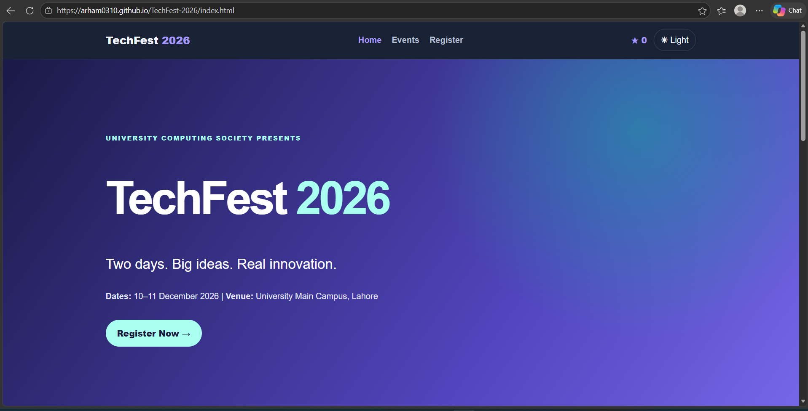

# TechFest 2026

## Advanced Web Technologies – Assignment 1

A responsive three-page event website developed using HTML5, CSS3 and Vanilla JavaScript.

## Project Pages

1. index.html – Home page
2. events.html – Events and filtering page
3. register.html – Registration page

## Technologies Used

- HTML5
- CSS3
- JavaScript
- LocalStorage

## Main Features

- Responsive navigation bar
- Light and dark theme
- Event cards generated through JavaScript
- Search functionality
- Event type filtering
- Day filtering
- Saved events using LocalStorage
- Registration form
- JavaScript form validation
- Responsive mobile-first design

## How to Run

1. Download or clone this repository.
2. Open the project folder in VS Code.
3. Open index.html in your browser.

## GitHub Repository

https://github.com/Arham0310/TechFest-2026

## Live Website

https://arham0310.github.io/TechFest-2026/

## Screenshot

Save your homepage screenshot inside a folder named screenshots.

## Author

Advanced Web Technologies Student
